# WITCHCRAFT TASK GRID

### This Go library defines reusable primitives for scheduling and running background work.

[Beginner map](#beginner-map) · [Original documentation](#original-documentation)

## Beginner map

**01 — Define a task** → **02 — Schedule or queue it** → **03 — Assign worker capacity** → **04 — Use cache or queue primitives** → **05 — Collect the result**

| Signal | What it means |
|---|---|
| **Input** | The starting request, file, data, or question |
| **Core** | The project’s main processing or navigation step |
| **Output** | The result a person reviews or uses |
| **Verification** | Check source, configuration, test evidence, maintenance, and license before relying on it |

> [!IMPORTANT]
> **Repository status:** Fork or mirror of Palantir’s `witchcraft-go-tasks`. Palantir’s original project identity, Go package path, documentation links, history, and Apache 2.0 license are preserved. No Palantir affiliation is implied.

<strong>Accessible motion</strong>

The SVG includes descriptive text and automatically disables animation when **Reduce Motion** is enabled. It uses no JavaScript, trackers, autoplay video, or external image host.

---

## Original documentation

witchcraft-go-tasks
===================

`witchcraft-go-tasks` defines primitives for background task execution, runnable tasks, job scheduling, worker pools, caches and queues.

License
-------
This project is made available under the [Apache 2.0 License](http://www.apache.org/licenses/LICENSE-2.0).
